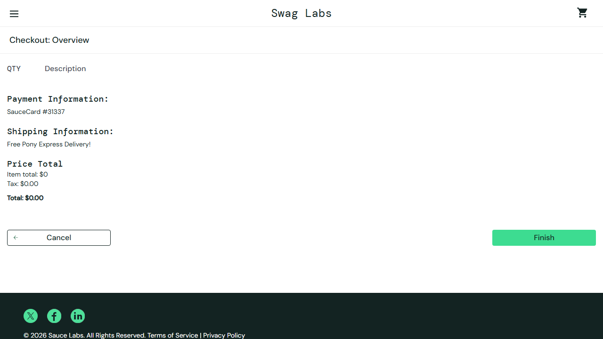
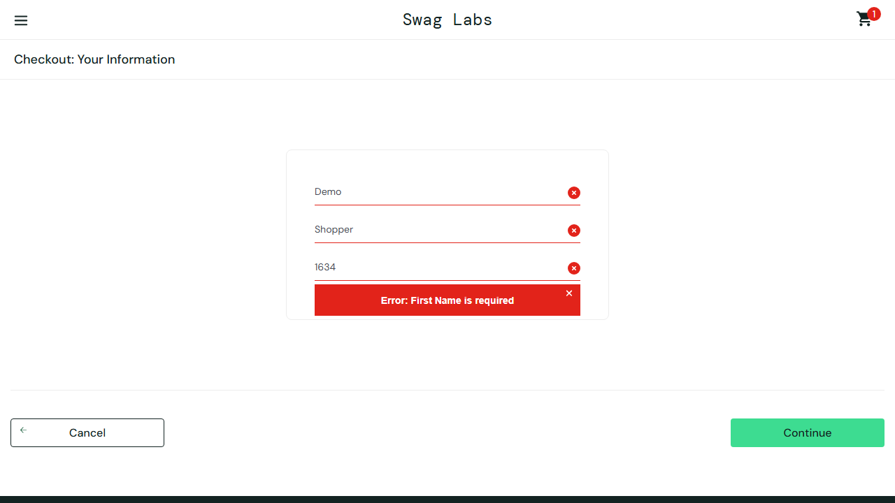
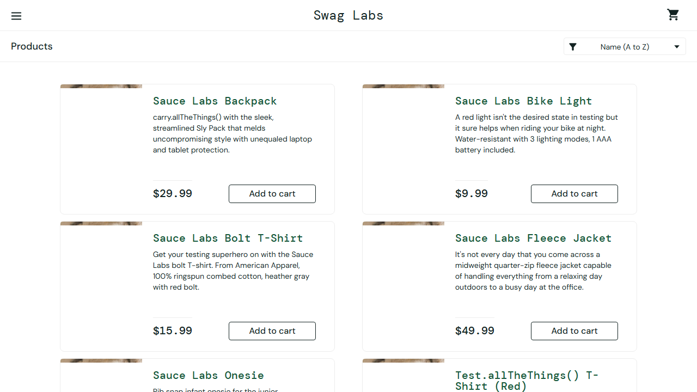

# SauceDemo UX review

I prioritized three moments that affect a shopper’s confidence in the cart or checkout. Evidence comes from live Playwright runs on desktop Chromium. SauceDemo uses public demo accounts and simulated orders.

## SD-01 · An empty cart accepts checkout

**Priority:** High for a real store · **Account:** `standard_user`

Open the cart without adding anything. Choose **Checkout**, fill the three fields with demo values, then choose **Continue** and **Finish**. The overview shows zero products and a **$0.00** total. The final screen says “Thank you for your order!”

As a shopper, I’d expect an empty cart to help me get back to the products. Seeing a confirmation after I enter my details makes it easy to believe I placed an order.

**Recommendation.** Show an empty-cart message and make the existing **Continue Shopping** button the primary action. Require at least one item before checkout opens or an order can be confirmed.

[Order confirmation after selecting Finish](screenshots/sd-01-confirmation.png)

## SD-02 · Checkout still flags a field after it’s corrected

**Priority:** Medium · **Account:** `standard_user`

Add a backpack and open checkout. Choose **Continue** with the form blank, then fill all three fields. The form still says “First Name is required” and shows red error icons on the filled fields. Continuing again opens the overview.

As a shopper, I can’t tell whether the form accepted the details I entered. The error and the field value give conflicting feedback.

**Recommendation.** Put each message beside the relevant field. Once a field is corrected, clear its error and flag any fields that still need attention.

## SD-03 · Adding the fleece jacket fails silently

**Priority:** High for the affected shopper · **Account:** `problem_user` (intentionally faulty persona)

Select **Add to cart** on **Sauce Labs Fleece Jacket**. The button keeps the same label, there’s no visible error or cart badge, and the cart shows no items. In a fresh `standard_user` session, the same click changes the button to **Remove** and the cart badge shows **1**.

As a shopper, I’d want to know whether the click worked. The silence leaves me guessing whether to retry or give up on the item.

**Recommendation.** Update the button and badge when an item is successfully added. If the action fails, show a short message near the button with a way to retry.

[Empty cart after the add attempt](screenshots/sd-03-empty-cart.png)

The [automated reproductions](../tests/defects.spec.ts) check these outcomes and attach fresh screenshots to the HTML report.
